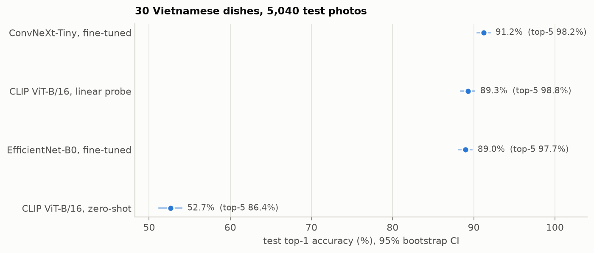
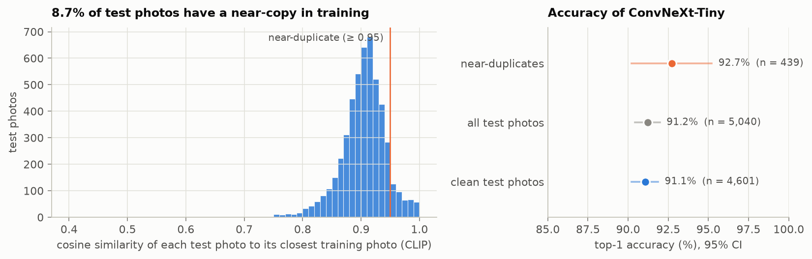
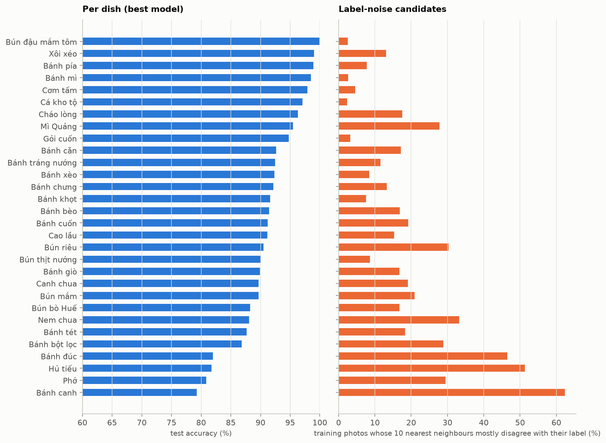
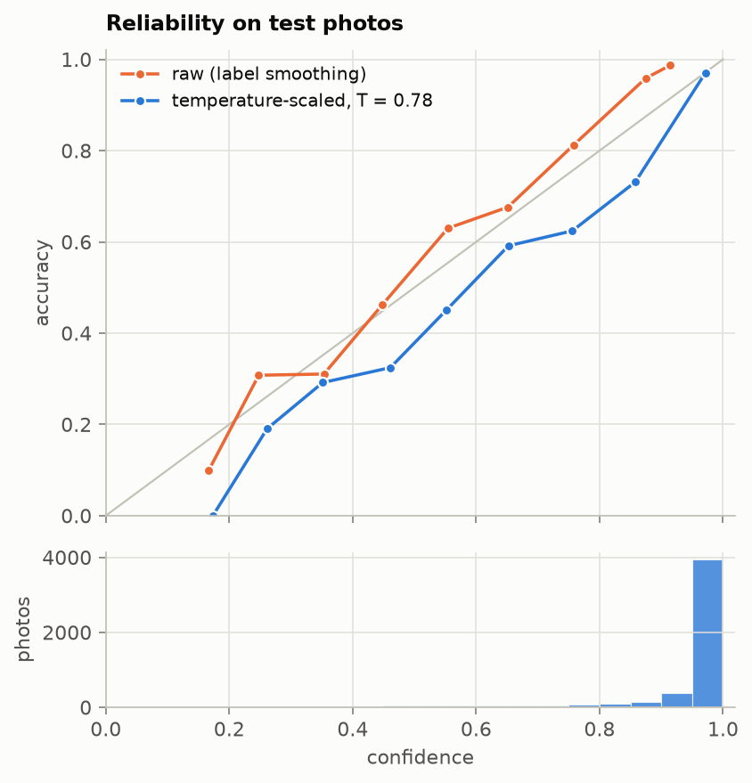

# vietnamese-food-recognition

[](https://github.com/hoang-stack/vietnamese-food-recognition/actions/workflows/ci.yml)


**Recognising 30 Vietnamese dishes from photos, and checking whether the benchmark can be
trusted first.** On [30VNFoods](https://www.kaggle.com/datasets/quandang/vietnamese-foods)
(25,136 web images), this project:

1. **audits the data**: near-duplicate photos shared between the training and test sets
   (perceptual hashes and CLIP embeddings), and label-noise candidates (photos whose nearest
   neighbours carry another label);
2. **compares four models** under the same protocol: CLIP zero-shot, a linear probe on frozen CLIP
   features, and fine-tuned ConvNeXt-Tiny and EfficientNet-B0;
3. **calibrates** the predicted probabilities (temperature scaling, ECE);
4. **ships the small model** as a 16 MB ONNX file served on a CPU (no PyTorch at inference), with
   an upload page.

Training runs on a free Kaggle T4 GPU ([kaggle/train_food.py](kaggle/train_food.py)). Everything
else, from analysis to report and demo, runs locally on CPU.

## Results

5,040 test photos, 30 dishes. The original paper reported 77.5% top-1 on this dataset.

| Model | Top-1 (95% CI) | Top-5 | Macro-F1 | ECE raw → temperature-scaled | Parameters |
| --- | ---: | ---: | ---: | ---: | ---: |
| **ConvNeXt-Tiny, fine-tuned** | **91.2%** (90.4–92.0) | 98.2% | 0.913 | 0.074 → 0.018 | 27.8M |
| CLIP ViT-B/16, linear probe | 89.3% (88.4–90.1) | **98.8%** | 0.894 | 0.076 → 0.015 | 15k trained |
| EfficientNet-B0, fine-tuned (**served, ONNX**) | 89.0% (88.2–89.8) | 97.7% | 0.889 | 0.087 → 0.012 | 4.0M |
| CLIP ViT-B/16, zero-shot | 52.7% (51.2–54.0) | 86.4% | 0.503 | 0.035 → 0.023 | 0 trained |



### Takeaways

1. **Fine-tuning a small modern CNN beats the published baseline by 13.7 points** (91.2% vs
   77.5%). A plain logistic regression on frozen CLIP features gets within 2 points of it, and it
   trains in about a minute on a CPU.
2. **CLIP does not know Vietnamese food zero-shot**: 52.7% top-1, even with descriptive English
   prompts. The right dish is usually in its top 5 (86%), though, so the features are there and a
   linear probe recovers them.
3. **The benchmark leaks, but only a little.** 439 test photos (8.7%) have a near-copy in the
   training set, and 64 are pixel-level duplicates. Removing them lowers ConvNeXt's accuracy by
   only 0.1 points. Duplicated photos are easier for every model, *including zero-shot CLIP, which
   never saw the training set* (61.5% vs 51.8%), so the gap reflects photo difficulty more than
   memorisation.
4. **Duplicates expose label noise.** 8.7% of the near-duplicate pairs carry *different* labels
   in train and test, so the same photo is labelled as two dishes.
5. **The errors are culinary.** The most confused pairs are look-alike noodle soups (bánh canh ↔
   hủ tiếu, phở ↔ bún bò Huế ↔ bún riêu), cao lầu ↔ mì Quảng, bánh khọt ↔ bánh căn and bánh tét
   ↔ bánh chưng. Bánh đúc, which the dataset authors flag as noisy, is among the four weakest
   classes.
6. **Label smoothing makes the models *under*-confident.** The fitted temperature is below 1
   (T ≈ 0.78), and temperature scaling cuts the calibration error by about 4× without changing a
   single prediction.

## Protocol

- **Splits:** the dataset's own Train / Validate / Test folders (17,581 / 2,515 / 5,040 photos).
  Every choice (epoch, linear-probe regularisation, temperature) is made on Validate. Test is
  only used for the final numbers.
- **Models:** CLIP ViT-B/16 zero-shot with descriptive English prompts per dish
  ([classes.py](src/vnfood/classes.py)); a logistic-regression probe on the same frozen
  embeddings; `convnext_tiny.fb_in22k_ft_in1k` and `efficientnet_b0.ra_in1k` from timm,
  fine-tuned for 10 epochs (AdamW, cosine schedule, label smoothing 0.1, random resized crops,
  flips and colour jitter, mixed precision). The best epoch is chosen on Validate.
- **Near-duplicate definition:** a test photo whose 64-bit perceptual hash is within Hamming
  distance 8 of a training photo, *or* whose CLIP embedding has cosine ≥ 0.95 with one.
- **Uncertainty:** 95% bootstrap CIs over test photos.

## Data audit



| | ConvNeXt-T | CLIP probe | EfficientNet-B0 | CLIP zero-shot |
| --- | ---: | ---: | ---: | ---: |
| All 5,040 test photos | 91.2% | 89.3% | 89.0% | 52.7% |
| 4,601 clean photos | 91.1% | 88.8% | 88.7% | 51.8% |
| 439 near-duplicates | 92.7% | 94.1% | 91.8% | 61.5% |



A **label-noise candidate** is a training photo whose 10 nearest neighbours in CLIP space mostly
(≥ 7) have another label. The rate is high for noodle soups that CLIP itself cannot tell apart
(bánh canh 62%, hủ tiếu 51%), so it flags classes to *review*. It does not measure errors. It
does single out bánh đúc (46%), the class the dataset authors warn about.

## Calibration



With label smoothing (ε = 0.1) the raw model rarely says more than about 92%, yet it is right
99% of the time when it does. A single temperature fitted on Validate moves most predictions to
the 95–100% bin, where confidence and accuracy then agree. The few photos in the middle bins
stay noisy.

## Serving

`efficientnet_b0.onnx` (16 MB) reproduces the PyTorch logits to within 5 × 10⁻⁶ and runs in about
9 ms per photo on a CPU with ONNX Runtime. [predict.py](src/vnfood/predict.py) applies the same
resize/crop/normalise as validation, then the fitted temperature, so the probabilities shown on
the upload page are calibrated.

## Quickstart

```bash
git clone https://github.com/hoang-stack/vietnamese-food-recognition.git
cd vietnamese-food-recognition
python -m venv .venv && source .venv/bin/activate
pip install -e ".[dev,serve]"
pytest                                  # unit tests (metrics, analysis, API with a stub model)
```

Train on Kaggle: attach the `quandang/vietnamese-foods` dataset plus a dataset containing
`src/vnfood`, copy `kaggle/kernel-metadata.example.json` to `kernel-metadata.json` with your
username, then run `kaggle kernels push -p kaggle --accelerator NvidiaTeslaT4`. Download the
outputs to `kaggle/output/main/`. Copy `efficientnet_b0.onnx` and `classes.json` into
`artifacts/`, then:

```bash
vnfood report                           # figures + reports/results.md
vnfood predict my_photo.jpg             # top-5 dishes
vnfood serve                            # upload page at http://127.0.0.1:8000
```

## Project layout

```text
kaggle/train_food.py    GPU pipeline: audit, 4 models, logits, ONNX export (PyTorch, timm, transformers)
src/vnfood/
├── classes.py          30 dishes: Vietnamese names and CLIP prompts
├── metrics.py          top-k, F1, ECE, temperature scaling, pHash Hamming search
├── analysis.py         model table, leakage, label noise, confusions, per-class accuracy
├── report.py           figures + reports/results.md (no dataset images are reproduced)
├── predict.py          ONNX Runtime inference with the validation-time preprocessing
├── api.py, cli.py, static/index.html
```

## Data and licence

30VNFoods is published under **CC BY-NC-SA 4.0** by its authors (Nguyen et al., *A dataset for
Vietnamese food images recognition*, IEEE 2021). This repository contains **no images and no
trained weights**: the data is attached to the Kaggle job, and the exported model stays local.
Using the data or a model trained on it is restricted to non-commercial purposes. The code is
MIT.

## Limitations

- **Training may not have converged.** ConvNeXt-Tiny's validation accuracy was still rising
  at the 10th and last epoch, so more epochs (or a larger backbone) would likely help.
- **The splits are the dataset's own.** Near-duplicates are measured and reported, but they
  are not removed from training. A de-duplicated re-split would be the cleaner benchmark.
- **Label-noise candidates are not verified.** Confirming them needs a human review, or a
  confident-learning pass with cross-validated predictions from the fine-tuned models.
- **Web photos.** The images are crawled and staged. Accuracy on phone photos taken in
  restaurants has not been measured.
- **One run per model,** so the CIs reflect only the sampling of test photos.

## References

- Radford, A. et al. (2021). Learning transferable visual models from natural language supervision (CLIP). *ICML.*
- Liu, Z. et al. (2022). A ConvNet for the 2020s (ConvNeXt). *CVPR.*
- Tan, M., Le, Q. (2019). EfficientNet: rethinking model scaling for CNNs. *ICML.*
- Guo, C., Pleiss, G., Sun, Y., Weinberger, K. (2017). On calibration of modern neural networks. *ICML.*
- Northcutt, C., Athalye, A., Mueller, J. (2021). Pervasive label errors in test sets destabilize machine learning benchmarks. *NeurIPS Datasets and Benchmarks.*
- Barz, B., Denzler, J. (2020). Do we train on test data? Purging CIFAR of near-duplicates. *Journal of Imaging.*
